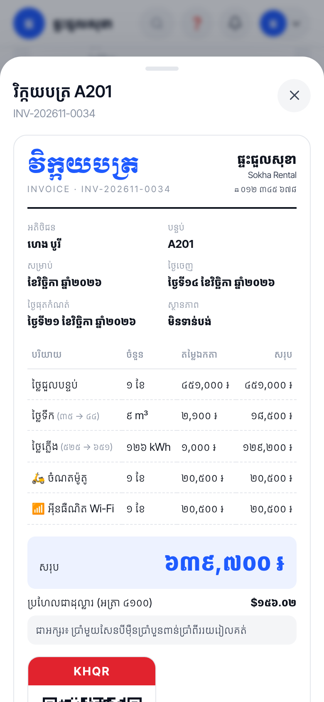
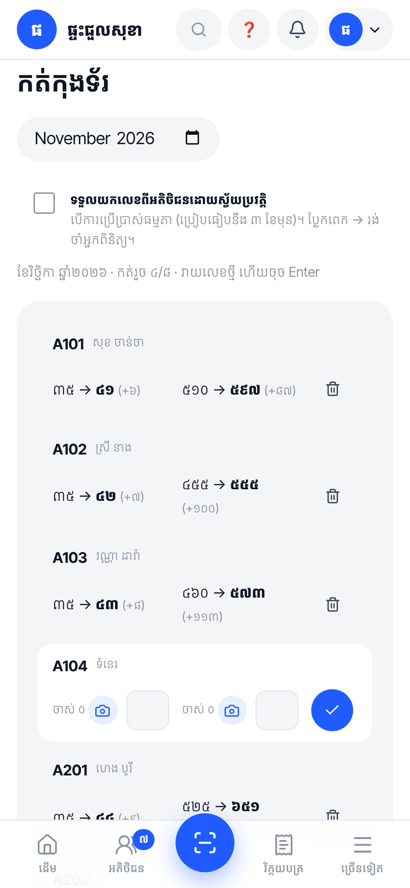
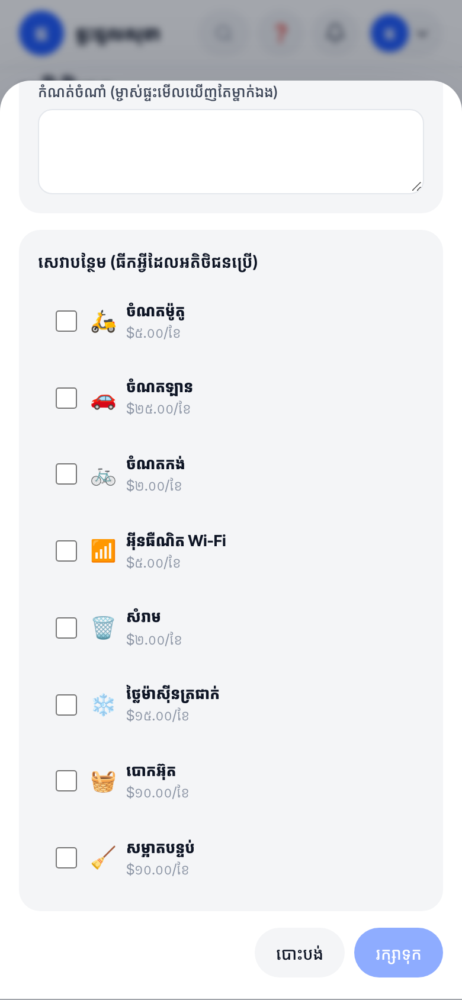
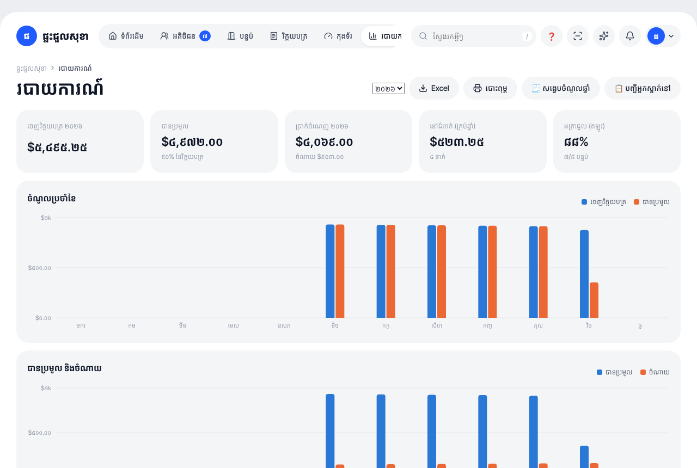

<div align="center">


# ផ្ទះយើង · Phteah Yeung

**កម្មវិធីគ្រប់គ្រងផ្ទះជួល សម្រាប់ម្ចាស់ផ្ទះខ្មែរ — ឥតគិតថ្លៃ ងាយស្រួល និងធ្វើការដោយស្វ័យប្រវត្តិ**

Rental management built for Cambodian landlords: Khmer first, Telegram and KHQR at the centre, and most of the monthly work done automatically.

</div>

<p align="center">
  
  
  
  
</p>

## សង្ខេបជាភាសាខ្មែរ

- **ម្តងក្នុងមួយខែ ៥ នាទី៖** កត់កុងទ័រ → ប្រព័ន្ធចេញវិក្កយបត្រ ផ្ញើតាម Telegram ជាមួយ KHQR ហើយរំលឹកអ្នកមិនទាន់បង់ដោយខ្លួនឯង។
- **លុយជារៀល ឬដុល្លារ** · បង់ខ្លះ · ប្រាក់កក់ · ថ្លៃបង់យឺត · ថ្ងៃបង់តាមថ្ងៃបើកប្រាក់ខែ។
- **អតិថិជន៖** ស្កេនអត្តសញ្ញាណប័ណ្ណ កិច្ចសន្យាចុះហត្ថលេខាលើទូរស័ព្ទ ជួលរួមគ្នា និងគេហទំព័រផ្ទាល់ខ្លួន (បើកក្នុង Telegram)។
- **ទិន្នន័យជារបស់ម្ចាស់ផ្ទះ៖** បម្រុងទុកចុចម្តង នាំចេញ ឬលុបបានគ្រប់ពេល។
- ការណែនាំជាភាសាខ្មែរមាននៅក្នុងកម្មវិធី៖ ចុច ❓ លើអេក្រង់ណាមួយ។

## What a landlord does, and what the app does for them

| The landlord | The app, automatically |
| --- | --- |
| Reads the meters (or lets tenants send them, or photographs them) | Creates each room's invoice: rent, water, electricity (flat or tiered), add-ons, old balance |
| Nothing | Sends every invoice to the tenant's Telegram with a KHQR for the exact amount, on the chosen day |
| Nothing | Reminds unpaid tenants — from their payday, never on public holidays |
| Nothing (with a Bakong token) | Confirms KHQR payments with Bakong and sends the receipt |
| Taps ✅ on a bank screenshot | Reads the amount and transaction number from the screenshot and warns about reused slips |
| Nothing | Adds the late fee once, carries unpaid balance to next month, repeats monthly expenses, backs up to Telegram weekly |

## Features

### Money
- **Riel or dollars.** One billing currency per landlord; everything converts in one step. Riel is rounded to 100 ៛, the KHQR is issued in the same currency, and invoices show the other currency and the amount in Khmer words.
- **KHQR on every invoice**, generated from the landlord's own bank KHQR (personal or merchant).
- **Automatic confirmation** through the NBC Bakong Open API: an invoice is marked paid only when the money reached the landlord's account, in the right currency and amount.
- **Bank screenshot reading** (ABA, ACLEDA, Wing…) on the landlord's device.
- **Partial payments**, balance carried forward, **deposits and move-out settlement** with a printable Khmer slip.
- **Payday due dates**: a due day per tenant, optionally in two halves.
- **Expenses and profit**, with monthly expenses that repeat by themselves.

### Rooms and meters
- 3D building designer, room features (air-con, hot water…), photos, and **shared rooms** with several tenants on one bill.
- **Meter photos**: the phone reads the number; the photo is kept as proof.
- **Tenants send their own readings** by bot or portal; normal readings can be approved automatically.
- **Works offline** for meter reading; readings sync when the signal returns.
- Tiered prices (EDC-style bands) and meters shared between rooms.

### Tenants
- Full profile with **Khmer ID card OCR** on the device (Chakkhu), auto-cropped and straightened.
- Khmer contract with **finger signature**; move-in invoice for deposit + prepaid rent.
- A private page per tenant (no app to install) that also **opens inside Telegram**.
- Announcements to everyone, one building, or chosen rooms.
- A **public vacant-rooms page** to share on Facebook and Telegram; inquiries arrive in the Inbox.
- A **public map of vacant rooms** (`/map`) from every landlord who opts in: price pins, filters for price, air-con, hot water and Wi-Fi, "near me", and a list view. Only empty rooms are shown, never tenant details.

### Made for Cambodia
- Khmer interface, Khmer numerals, Chhankitek lunar date, and public holidays: due dates move off holidays, reminders pause, and optional greetings go out for Khmer New Year, Pchum Ben and the Water Festival.
- Address picker down to the village (pumi), map pin, and a Google Maps link on invoices.
- **Printable resident list** for the village chief or commune police, and a **yearly rental income summary**.
- **Simple mode**: large text and four big actions for landlords who want only the essentials.

### Running it as a platform
- Free signup; each landlord's data is separate. **Several properties** under one login.
- **Team roles**: owner, manager, staff (staff never see money or ID cards).
- Web Push and Telegram notifications, installable PWA, dark mode.
- One-click **backup and restore**, optional storage in the landlord's own Google Drive or Cloudflare R2.
- Super admin: statistics, announcements, feature requests, and an error log with personal data removed.

<p align="center">
  
  
  
  
</p>
<p align="center"></p>

Screenshots are generated from a demo account with invented names.

## Run it on your computer

Requires Node.js 22 or newer. No database to install: an embedded one is created under `./data`.

```bash
npm install
npm run dev        # http://localhost:5173
```

```bash
npm test           # 64 tests: embedded database, fake Telegram, Bakong and push services
npm run build && npm start
```

## Deploy free: Vercel + Neon

1. Create a Postgres database at [neon.tech](https://neon.tech) and copy the **pooled** connection string.
2. Import this repository in [Vercel](https://vercel.com).
3. Add environment variables (Project → Settings → Environment Variables), then redeploy:

| Variable | Needed | Purpose |
| --- | --- | --- |
| `DATABASE_URL` | yes | Neon pooled connection string |
| `APP_SECRET` | yes | Long random string; encrypts stored tokens |
| `TELEGRAM_BOT_TOKEN`, `TELEGRAM_BOT_USERNAME` | recommended | Shared bot from @BotFather (username without `@`) |
| `CRON_SECRET` | recommended | Protects the daily job |
| `SUPER_ADMIN_EMAILS` / `SUPER_ADMIN_TELEGRAM_IDS` | optional | Platform owner accounts |
| `BAKONG_TOKEN` | optional | Automatic payment confirmation for all landlords (renew every 90 days) |
| `R2_*`, `GOOGLE_CLIENT_ID`, `GOOGLE_CLIENT_SECRET` | optional | Cloudflare R2 storage; landlords' own Google Drive |
| `VAPID_*` | optional | Push keys; generated automatically when empty |

See [`.env.example`](.env.example) for the full list. Never commit secrets.

## How it is built

| Part | Technology |
| --- | --- |
| Server | Node 22, Express 5. One JSON document per landlord in Postgres, locked per request. |
| Web app | React 19 + Vite, installable PWA, no UI framework |
| Telegram | Bot API by webhook (long polling locally) |
| OCR | Chakkhu model with onnxruntime-web, entirely in the browser |
| Tests | `node:test` with in-process fakes; GitHub Actions on every pull request |

## Privacy and security

- ID cards, bank slips, meter photos and signatures are private files: only that landlord (and the tenant concerned) can open them.
- OCR runs on the user's device. Photos are not sent to any OCR service.
- Passwords are hashed with scrypt; sessions are httpOnly cookies; sign-in, sign-up and public forms are rate limited.
- Every signed-in route is checked against a role table that denies by default.
- The platform owner manages the system, not landlords' data; there is no "download everyone's data" function.

## Limits to know about

- Automatic payment confirmation needs a Bakong developer token, which expires every 90 days.
- Push notifications on iPhone need the app added to the Home Screen (iOS 16.4+).
- Telegram backups are limited to 45 MB; larger accounts should use the download button or Drive storage.
- The resident list and income summary are general records. Local authorities and the tax office may require their own forms; this app does not give legal or tax advice.
- The map's optional "Google" and satellite layers load Google tiles directly. Check Google's terms before relying on them; OpenStreetMap is the default.

## Acknowledgements

This project stands on work shared by Khmer developers and the wider open-source community. Thank you.

| Work | By | Used for |
| --- | --- | --- |
| khmernumber, khmerword, split-khmer, is-khmer, pumi | **Seanghay Yath** | Khmer numbers, words, search and addresses |
| khmer-chhankitek-calendar | **Choch Kimhour** | Lunar calendar and holidays |
| Chakkhu OCR | **Ing Muyleang** | Reading ID cards, meters and bank slips |
| bakong-khqr | **Devit Huotkeo** / NBC KHQR SDK | KHQR |
| Kantumruy Pro | The Kantumruy Project Authors ([sovichet/kantumruy-pro](https://github.com/sovichet/kantumruy-pro)) | Interface font |
| Moul, Koulen, Bokor, Battambang, Siemreap | **Danh Hong** and project authors | Khmer display fonts |
| khmer-normalizer | Marc Durdin / SIL | Khmer text normalisation |

Full list with licences: [THIRD-PARTY-NOTICES.md](THIRD-PARTY-NOTICES.md).

## Licence

Third-party components keep their own licences (see the notices file). **The licence for this project's own code has not been chosen yet**, so until the owner adds a `LICENSE` file, all rights are reserved.
